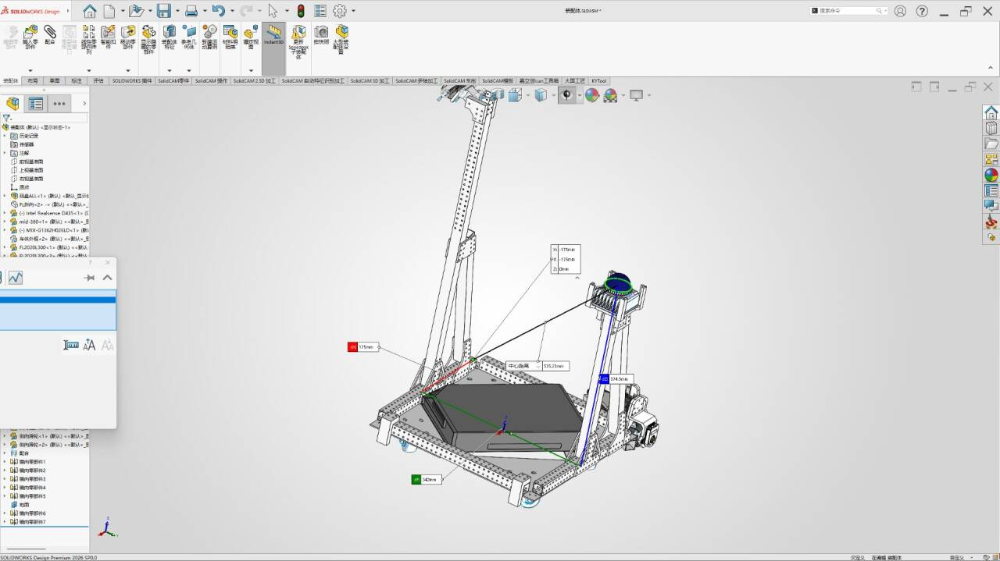

# 角点怎样从雷达定位算出来

## 数据路线

```text
MID-360点云+内置IMU → 驱动 → FAST-LIO → /Odometry
    → 角点刚体换算 → 固定初始角点坐标系 → 有界平滑/时效检查 → /vision/state
```

ROS话题是程序之间的数据通道；FAST-LIO输出不是约定角点坐标，需要任务三程序继续换算。
FAST-LIO一边用IMU预测短时间运动，一边用点云与局部地图的几何关系纠正，输出位置和完整姿态。
本车/Odometry为camera_init→body，body是IMU状态原点，不能直接当雷达半球中心或车心。

## 为什么转弯必须旋转机械偏移

车架角点与IMU之间的距离固定，但相对地面的方向随车转动。计算是：

```text
世界中的角点位置 = 世界中的body位置 + 当前body旋转矩阵 × body到角点的固定向量
p_corner = p_body + R_body × r_body_corner
```

完整程序先组合source→body→雷达→图示轴表达的角点，使用三维旋转/平移。
X/Y输出延期高度验证，不等于内部删掉Z；车有倾斜时竖直杆臂也可能影响水平位置。

当前配置（m）：

| 项目 | 值 |
|---|---|
| IMU/body→雷达内部平移 | (-0.011,-0.02329,+0.04412) |
| 雷达→指定角点，以图示轴表达 | (+0.175,+0.340,-0.3745) |
| lidar_to_diagram_rpy | (0,0,+π/2)，按代码R_L_D方向组合 |
| 组合body→角点平移 | (-0.351,+0.15171,-0.33038) |

安装方向约定：雷达+X朝图示-Y；图示轴在操作者俯视、面朝背离出线侧时，左为+X、后为+Y。
不能把图示向量直接当IMU向量，也不能把CAD负坐标取绝对值。机械没有拆改时沿用配置。

**目标点是指定的车架金属角点，不能临时改用另一角、轮胎接地点或万向轮转轴。**
选错参考点时，初始归零可能掩盖差异，转弯后会出现大偏移；遇到这种现象先认清实体点。

下图是现有MID-360侧机械标注参考：选点在底盘金属车架，标注dX175、dY340、dZ374.5mm。
截图标注的距离大小与程序带符号向量需结合上述轴约定理解，不以轮胎接地点代替。



## 固定地图原点与场地轴

正式O和轴向已由一次真实绑定保存。日常自动在同一地图中重定位，再计算T_field_corner=T_field_map*T_map_body*T_body_corner。
T_field_map固定，车辆当前姿态只影响T_map_body及角点杆臂旋转；日常不重新减去启动坐标，不把当前yaw设为零。
FAST-LIO的camera_init仍是每次会话的临时世界，自动全局候选提供地图初值，局部地图定位再发布map→body；不能简单改frame_id冒充地图定位。
地图原点/机械/正式O变化需维护者重新绑定；只把相同地图迁到新路径不改变reference_id。当前正式reference_id为task3_field_ebf9a987a46494ed80640aca。


## 平滑在做什么

车载自适应滤波min_cutoff=0.5Hz、beta=80、导数截止1Hz。慢时减小抖动，快时提高跟随速度。
每个采样时刻，平滑后XY与未经该层平滑的XY距离最多3mm；不是每帧只允许走3mm，也不是误差保证3mm。
源采样时间、姿态、内部Z不变，原始角点raw_odom保留；它不能消除长期厘米级偏差。

## 视觉需要车心时

当前与雷达侧约定交付角点，视觉自行换算。若r_C_H是“角点→车心”在车体图示轴中的真实向量，
水平简化条件下有：

```text
x_center = x_corner + cos(yaw)*r_x - sin(yaw)*r_y
y_center = y_corner + sin(yaw)*r_x + cos(yaw)*r_y
```

本包未确认该角点→车心向量，不拿雷达→角点尺寸代替它，不凭转动轨迹拟合后当机械真值。
要求完整倾斜姿态时，使用/vision/odom的姿态与一致的三维杆臂，且仍遵守有效性与Z边界。

## 维护者改哪里

- 机械/安装参数：config/car_task3_local.yaml，改变后需维护者重新绑定固定原点并验证。
- 上游FAST-LIO参数：config/car_fastlio.yaml，当前map/surf0.15m、iter3；修改须重启上游并重新自动定位，固定O保持。
- 刚体计算：src/task1_fusion/task1_fusion/corner.py、task3_config.py。
- 平滑/初始化：task3_quality.py、tools/task3_set_start.py。
- 接口与失效：vision.py、vision_node.py；接收示例tools/vision_subscriber.py。

看算法说明可以理解这些关系；视觉集成只需按接口约定订阅，不需要自行重写FAST-LIO。
